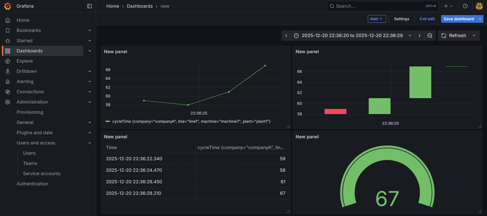

# Unified Automation Hub

A local, Docker-based hub that combines industrial data flows, AI agents and lean-manufacturing automation in one stack.

> **Status:** early release. Designed for local development and experimentation. Do not expose it to the internet without hardening it first.

## Services

| Service | Purpose | Default port |
|---|---|---|
| Node-RED | Industrial data flows, UNS simulation, alarms | 1881 |
| n8n | Autonomous workflows and AI-assisted automation | 5680 |
| Langflow | AI agent builder | 7862 |
| Ollama | Local LLM runtime | 11435 |
| InfluxDB 2.x | Time-series telemetry | 8087 |
| Grafana | Real-time factory dashboards | 3003 |
| EMQX | MQTT broker (dashboard on 18084) | 1884 |
| PostgreSQL | Relational database (used by n8n) | 5433 |

## Quick start

Requirements: Docker Desktop (or Docker Engine with Compose v2).

1. Copy the example environment file:
   `cp .env.example .env` (Windows PowerShell: `Copy-Item .env.example .env`)
2. Open `.env` and replace every `CHANGE_ME` with a strong, unique value.
3. Start the stack: `docker compose up -d`
4. Open the services from the table above, for example `http://localhost:3003` for Grafana.

Example workflows are in `uah-n8n-full-workflow.json` and `uah_import.json`. Import them from the n8n interface.

## Security notes

- Never commit your `.env` file. It is listed in `.gitignore`.
- Use strong passwords and tokens.
- Change default credentials of every service after the first start.

## Roadmap

- [x] Pin container image versions
- [x] Bind ports to localhost by default
- [ ] Health checks for all services
- [ ] Persistent storage for the EMQX broker
- [ ] Predictive-maintenance and lean-production example flows

## License

To be added.

## Notes for first-time setup

- Langflow and EMQX start empty on a fresh install. Create your own flows and broker settings.
- Services are bound to `127.0.0.1`, so they are reachable only from the machine running Docker.
- Image versions are pinned. Upgrade them one at a time and back up your volumes first.
- The EMQX dashboard user and password come from `EMQX_DEFAULT_USER` and `EMQX_DEFAULT_PASS` in `.env`. They apply only on the first start; change them in the dashboard afterwards.
- Tested on Docker Desktop for Windows with the stack in `docker-compose.yml`.

## Known issues

- The example workflow in `uah-n8n-full-workflow.json` has not been tested end to end. Review it before use.
- The "Postgres - Insert Audit Log" node puts MQTT values directly into the SQL text. Treat incoming data as untrusted and switch to query parameters before using it with real data.
- Credentials in the example use a `__REPLACE__` placeholder. Create your own Postgres and MQTT credentials after importing.

## Known issues

- The example workflow in `uah-n8n-full-workflow.json` has not been tested end to end. Review it before use.
- The "Postgres - Insert Audit Log" node puts MQTT values directly into the SQL text. Treat incoming data as untrusted and switch to query parameters before using it with real data.
- Credentials in the example use a `__REPLACE__` placeholder. Create your own Postgres and MQTT credentials after importing.

## Example: UNS alarm simulator (Node-RED)

`examples/nodered-uns-simulator.json` is a Node-RED flow that publishes simulated machine data to MQTT using a Unified Namespace topic layout (`uns/<tenant>/<site>/<area>/<asset>/...`).

What it does:

- Publishes random telemetry every 5 seconds (cycle time, nozzle temperature, vibration, energy) with occasional simulated anomalies.
- Publishes a retained machine status every 30 seconds.
- Turns warning and critical telemetry into alarm events using fixed thresholds.
- Includes nodes for alarm clearing, operator acknowledgement and duplicate-alarm filtering.
- Listens for commands on the `cmd` topic and answers with a result event.

Limitations:

- All data is simulated. No real machine is connected.
- The rules are fixed thresholds, not machine learning or real predictive maintenance.
- Commands such as `emergencyStop` only publish an event. They do not control any equipment. Never connect this flow to real machinery without proper safety engineering.
- The duplicate-alarm filter has not been verified and may not work as intended.
- The ACK button needs `node-red-dashboard` 3.6.6. Alarm storage and the alarm API live in other Node-RED tabs that are not part of this example.
- The HTTP node posts to an n8n webhook (`/webhook/uah-ai/analyze`) that is not included in this repository.

To try it: in Node-RED open the menu, choose Import, select the file, then point the MQTT broker node at your EMQX.

## Screenshots

Example Grafana dashboard showing cycle-time data for `companyA / plant1 / line1 / machine7`. The values come from an earlier test run and are sample data, not real machine data.

